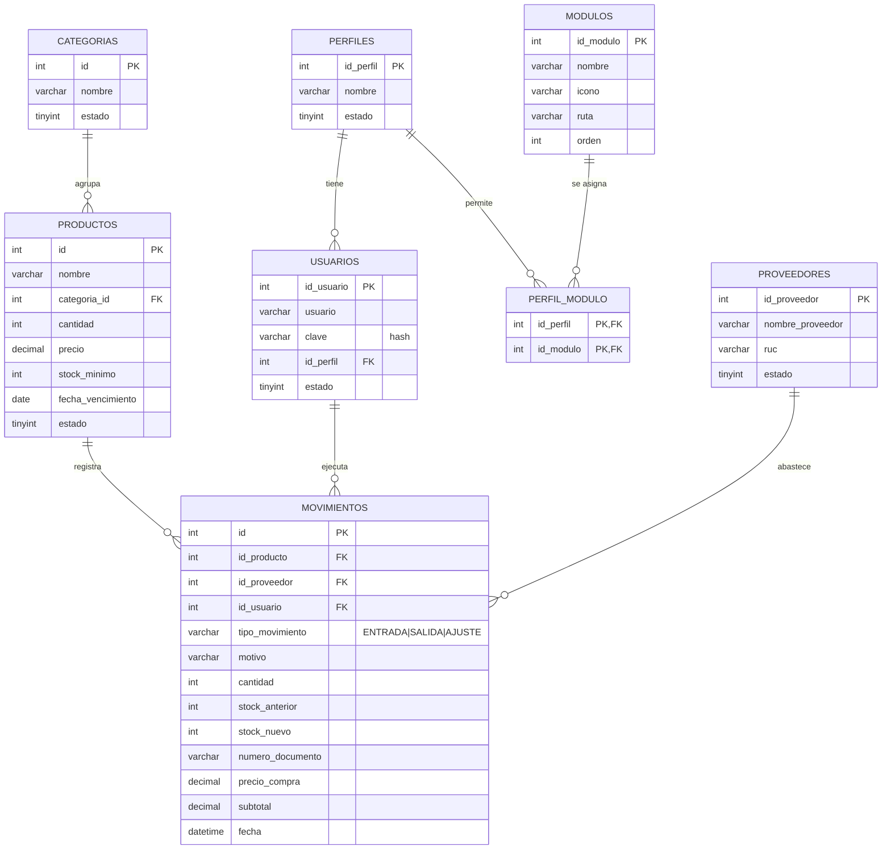

# Sistema de Inventario

Aplicación web de gestión de inventario desarrollada como proyecto de **Programación Multiparadigma**. Permite administrar productos, categorías, proveedores, usuarios y perfiles con permisos; registrar entradas, salidas y ajustes de stock con kardex; generar reportes con gráficos, predicción de reposición y exportación a Excel, PDF, CSV y JSON; e importar productos de forma masiva desde archivos CSV o JSON.

## Características

- **Autenticación** con sesión, contraseñas hasheadas y permisos por perfil (cada perfil ve solo sus módulos).
- **Catálogo**: productos (incluye perecederos con fecha de vencimiento), categorías y proveedores.
- **Inventario**: entradas, salidas y ajustes por producto, con historial (kardex), stock transaccional y documento obligatorio en compras y ventas.
- **Reportes** (6): valorizado, movimientos/kardex, reposición sugerida, vencimientos, bajo stock y compras por proveedor, con filtros, gráficos y exportación a **Excel**, **PDF**, **CSV** y **JSON**. Los cálculos usan operaciones vectorizadas de NumPy y pandas.
- **Importación masiva** de productos desde CSV o JSON: limpia y valida todas las filas, importa las válidas e informa el motivo de cada fila rechazada.
- **Innovación**: *predicción de reposición* (consumo diario, días hasta agotarse y cantidad sugerida de compra a partir del historial) y *alertas de vencimiento*.
- **Eliminación lógica** en 3 estados (activo / inactivo / eliminado) sin perder historial.
- **SPA sin recargas**: toda la navegación y las acciones ocurren sin recargar la página ni cambiar la URL.
- **Diseño responsivo**: en móvil las tablas colapsan con botón «+» (patrón DataTables) y las tarjetas se apilan.

## Tecnologías

| Capa | Tecnología |
|---|---|
| Backend | Python 3.12, Flask, MySQL (mysql-connector), NumPy, pandas, openpyxl, fpdf2 |
| Frontend | JavaScript (módulos ES), Bootstrap 5, Chart.js, SweetAlert2 |
| Base de datos | MySQL / MariaDB |
| Pruebas y calidad | pytest, flake8 (PEP 8) |

## Requisitos

- Python 3.10 o superior
- MySQL o MariaDB en ejecución (XAMPP, WAMP o instalación directa)

## Instalación

1. **Clonar/copiar el proyecto** y abrir una terminal en su raíz.

2. **Crear la base de datos**: ejecutar `schema.sql` en MySQL (phpMyAdmin → pestaña SQL, o consola):

   ```sql
   SOURCE schema.sql;
   ```

3. **Configurar credenciales** (opcional): si tu MySQL tiene contraseña u otros datos de conexión, crear un archivo `.env` en la raíz del proyecto con estas variables (sin `.env`, se usa `root` sin contraseña en `localhost`):

   ```env
   SECRET_KEY=una-clave-larga-y-aleatoria
   DB_HOST=localhost
   DB_USER=root
   DB_PASSWORD=tu-contraseña
   DB_NAME=inventario
   DB_PORT=3306
   PUERTO=5000
   ```

4. **Crear el entorno virtual e instalar dependencias**:

   ```powershell
   python -m venv venv
   venv\Scripts\activate
   pip install -r requirements.txt
   ```

5. **Ejecutar las pruebas** (desde la raíz del proyecto; no necesitan MySQL):

   ```powershell
   pytest
   ```

6. **Arrancar el servidor**:

   ```powershell
   cd backend
   python app.py
   ```

7. Abrir **http://localhost:5000** e iniciar sesión:

   | Usuario | Clave |
   |---|---|
   | `admin` | `admin123` |

   La primera vez, el sistema siembra automáticamente el perfil Administrador, los módulos del menú, proveedores, categorías y productos de ejemplo.

## Importar productos

En **Productos → Importar** se puede subir un archivo `.csv` o `.json` (máximo 2 MB y 1000 filas) con estas columnas:

| Columna | Obligatoria | Formato |
|---|---|---|
| `nombre` | Sí | Texto |
| `categoria` | Sí | Nombre de una categoría existente |
| `cantidad` | Sí | Entero no negativo |
| `precio` | Sí | Número no negativo |
| `stock_minimo` | No | Entero no negativo (por defecto 5) |
| `fecha_vencimiento` | No | `AAAA-MM-DD`, no anterior a hoy |

La carpeta `data/` incluye `productos_ejemplo.csv`, `productos_ejemplo.json` y `productos_con_errores.csv` (este último con errores a propósito para ver la validación).

## Pruebas y calidad

```powershell
pytest            # 165 pruebas: modelos, patrones, servicios, roles, reportes, importación, validadores y API
pytest -v         # con el nombre de cada prueba
pip install flake8
flake8            # revisión PEP 8 con la configuración de .flake8
```

Las pruebas reemplazan los repositorios por versiones en memoria, así que se ejecutan sin base de datos.

## Guía para probar el sistema

Recorrido sugerido después de instalar, con lo que debería ocurrir en cada paso. Los datos de ejemplo se cargan solos la primera vez que arranca el servidor.

### 1. Acceso
1. Abrir http://localhost:5000 e ingresar con una clave incorrecta: aparece *"Usuario o clave incorrectos"*.
2. Ingresar con `admin` / `admin123`: se abre el **Dashboard** con indicadores, gráficos y alertas de bajo stock y vencimiento.

### 2. Catálogo
1. **Productos → Nuevo producto**: crear uno con cantidad negativa. El formulario lo impide con un mensaje.
2. Crear un producto válido: aparece en la tabla y se actualizan las tarjetas de resumen.
3. Crear un producto con fecha de vencimiento: queda como **perecedero**.
4. Editar, desactivar y eliminar un producto: el eliminado deja de verse, pero su historial se conserva (eliminación lógica).

### 3. Movimientos de inventario
1. **Inventario**: registrar una **entrada**. Exige proveedor, N° de documento y precio de compra, y el stock aumenta.
2. Registrar una **salida por venta**: exige N° de documento y el stock disminuye.
3. Intentar una salida mayor al stock: se rechaza con *"No hay stock suficiente"*.
4. Revisar el **kardex** del producto: muestra stock anterior y stock nuevo de cada movimiento.

### 4. Importación masiva
1. **Productos → Importar** con `data/productos_ejemplo.csv`: se importan **15** productos.
2. Importar `data/productos_ejemplo.json`: se importan **7**.
3. Importar `data/productos_con_errores.csv`: **2** importados y **8** rechazados, con la fila y el motivo de cada rechazo (nombre vacío, cantidad negativa, precio no numérico, fecha pasada, categoría inexistente, repetido en el archivo y ya existente).
4. Volver a importar `productos_ejemplo.csv`: los 15 se rechazan por estar ya registrados.
5. Elegir un archivo `.txt` o `.xlsx`: se rechaza antes de subirlo.

### 5. Reportes y exportación
1. Abrir cada uno de los 6 reportes: **valorizado**, **movimientos**, **reposición**, **vencimientos**, **bajo stock** y **compras por proveedor**.
2. En **Reposición**, cambiar la ventana de días: se recalculan el consumo diario, los días restantes, la cantidad sugerida y la urgencia.
3. En cualquier reporte, **Exportar** en Excel, PDF, CSV y JSON: se descarga el archivo y respeta los filtros aplicados.

### 6. Usuarios, perfiles y permisos
1. **Perfiles**: el perfil **Administrador** aparece con la insignia *Sistema* y sin botones de edición. No se puede modificar, desactivar ni eliminar.
2. Crear un perfil **Vendedor** solo con los módulos *Dashboard*, *Productos* e *Inventario*.
3. **Usuarios**: crear un usuario con el perfil Vendedor, cerrar sesión e ingresar con él: el menú muestra solo esos tres módulos.
4. Como `admin`, editar ese usuario y asignarle el perfil **Administrador**: el sistema pide confirmar que tendrá acceso a todo el sistema. Al cancelar, no se guarda nada.
5. Intentar quitarle el rol Administrador a `admin` cuando es el único administrador: se rechaza para que el sistema no quede sin administrador.
6. Intentar desactivar o eliminar el propio usuario: se rechaza.

### 7. Pruebas automáticas
Desde la raíz del proyecto ejecutar `pytest`: deben pasar las **165** pruebas, sin necesidad de MySQL.

## Estructura del proyecto

```
SistemaInventario/
├── schema.sql               # Estructura de la base de datos
├── requirements.txt
├── pyproject.toml           # Configuración de pytest
├── .flake8                  # Configuración de PEP 8
├── docs/PARADIGMAS.md       # POO, patrones, vectorización y excepciones
├── data/                    # Archivos CSV/JSON de ejemplo
├── tests/                   # Pruebas unitarias (pytest)
├── backend/
│   ├── app.py               # Punto de entrada (Flask)
│   ├── config.py            # Configuración (lee .env)
│   ├── sesion.py            # Sesión y permisos por módulo
│   ├── validadores.py       # Validaciones reutilizables
│   ├── seed_data.py         # Datos iniciales
│   ├── models/              # POO: entidades y reglas propias
│   ├── patterns/            # Factory Method, Strategy y Singleton
│   ├── repositories/        # Acceso a MySQL (SQL)
│   ├── services/            # Reglas de negocio, reportes, importación y exportación
│   ├── controllers/         # Petición HTTP → service → JSON
│   ├── routes/              # URLs (blueprints) + permisos
│   └── exceptions/          # Errores del dominio con código HTTP
└── frontend/
    ├── index.html           # Shell de la SPA (login + layout)
    ├── css/estilos.css
    ├── js/
    │   ├── main.js          # Arranque y sesión
    │   ├── router.js        # Navegación sin recargas + tablas responsivas
    │   ├── api/             # Única capa que habla con el backend
    │   ├── utils/           # Helpers y validaciones
    │   └── views/           # Lógica de cada módulo y reporte
    └── views/               # Fragmentos HTML de cada módulo
```

## Diagrama entidad-relación



> Los estados son: `1` activo, `0` inactivo, `2` eliminado (eliminación lógica).

## Paradigmas y patrones

| Aspecto | Aplicación |
|---|---|
| **Orientado a objetos** | Clase abstracta `ModeloBase`; encapsulamiento con propiedades validadas en `Producto` y `Movimiento`; herencia `ProductoPerecedero → Producto` y jerarquía de excepciones; polimorfismo en `tipo`, `to_dict()` y `exportar()`. |
| **Patrones de diseño** | **Factory Method** para crear productos, **Strategy** para los formatos de exportación y **Singleton** para el pool de conexiones (`backend/patterns/`). |
| **Funcional** | Indicadores con `reduce`, `filter` y `lambda` en `services/reportes_service.py`. |
| **Vectorizado** | Reportes e importación con operaciones de NumPy y pandas sobre columnas completas. |
| **Declarativo** | Consultas SQL y agregaciones de pandas. |
| **Orientado a eventos** | Frontend que reacciona a las acciones del usuario sin recargar la página. |

El detalle, con la justificación de cada decisión y su ubicación en el código, está en [docs/PARADIGMAS.md](docs/PARADIGMAS.md).
