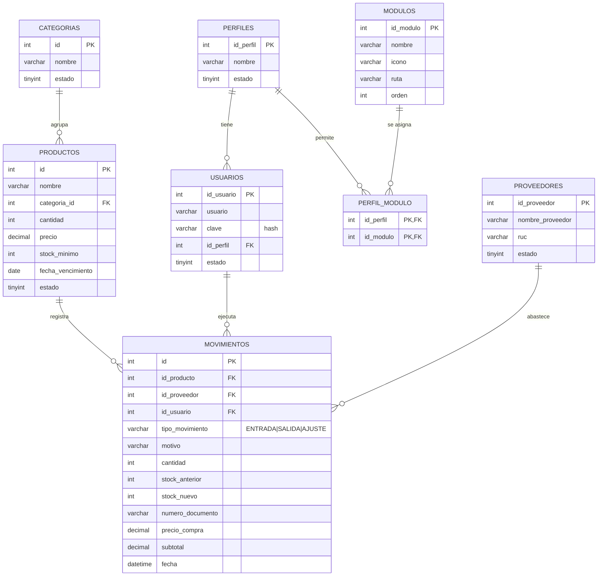

# Sistema de Inventario

Aplicación web de gestión de inventario desarrollada como proyecto de **Programación Multiparadigma**. Permite administrar productos, categorías, proveedores, usuarios y perfiles con permisos; registrar entradas, salidas y ajustes de stock con kardex; y generar reportes con gráficos, exportación a Excel/PDF y predicción de reposición.

## Características

- **Autenticación** con sesión, contraseñas hasheadas y permisos por perfil (cada perfil ve solo sus módulos).
- **Catálogo**: productos (incluye perecederos con fecha de vencimiento), categorías y proveedores.
- **Inventario**: entradas, salidas y ajustes por producto, con historial (kardex), stock transaccional y documento obligatorio en compras y ventas.
- **Reportes** (6): valorizado, movimientos/kardex, reposición sugerida, vencimientos, bajo stock y compras por proveedor — con filtros, gráficos y exportación a **Excel** (pandas) y **PDF** (fpdf2).
- **Innovación**: *predicción de reposición* (consumo diario, días hasta agotarse y cantidad sugerida de compra a partir del historial) y *alertas de vencimiento*.
- **Eliminación lógica** en 3 estados (activo / inactivo / eliminado) sin perder historial.
- **SPA sin recargas**: toda la navegación y las acciones ocurren sin recargar la página ni cambiar la URL.
- **Diseño responsivo**: en móvil las tablas colapsan con botón «+» (patrón DataTables) y las tarjetas se apilan.

## Tecnologías

| Capa | Tecnología |
|---|---|
| Backend | Python 3.12, Flask, MySQL (mysql-connector), pandas, openpyxl, fpdf2 |
| Frontend | JavaScript (módulos ES), Bootstrap 5, Chart.js, SweetAlert2 |
| Base de datos | MySQL / MariaDB |

## Requisitos

- Python 3.10 o superior
- MySQL o MariaDB en ejecución (XAMPP, WAMP o instalación directa)

## Instalación

1. **Clonar/copiar el proyecto** y abrir una terminal en su raíz.

2. **Crear la base de datos**: ejecutar `schema.sql` en MySQL (phpMyAdmin → pestaña SQL, o consola):

   ```sql
   SOURCE schema.sql;
   ```

3. **Configurar credenciales** (opcional): si tu MySQL tiene contraseña u otros datos de conexión, crear un archivo `.env` en la raíz del proyecto con estas variables (sin `.env`, se usa `root` sin contraseña en `localhost`):

   ```env
   SECRET_KEY=una-clave-larga-y-aleatoria
   DB_HOST=localhost
   DB_USER=root
   DB_PASSWORD=tu-contraseña
   DB_NAME=inventario
   DB_PORT=3306
   PUERTO=5000
   ```

4. **Crear el entorno virtual e instalar dependencias**:

   ```powershell
   python -m venv venv
   venv\Scripts\activate
   pip install -r requirements.txt
   ```

5. **Ejecutar las pruebas** (desde la raíz del proyecto):

   ```powershell
   pytest
   ```

6. **Arrancar el servidor**:

   ```powershell
   cd backend
   python app.py
   ```

7. Abrir **http://localhost:5000** e iniciar sesión:

   | Usuario | Clave |
   |---|---|
   | `admin` | `admin123` |

   La primera vez, el sistema siembra automáticamente el perfil Administrador, los módulos del menú, proveedores, categorías y productos de ejemplo.

## Estructura del proyecto

```
SistemaInventario/
├── schema.sql               # Estructura de la base de datos
├── requirements.txt
├── pyproject.toml           # Configuración de pytest
├── data/                    # Archivos CSV/JSON de ejemplo
├── tests/                   # Pruebas unitarias (pytest)
├── backend/
│   ├── app.py               # Punto de entrada (Flask)
│   ├── config.py            # Configuración (lee .env)
│   ├── sesion.py            # Sesión y permisos por módulo
│   ├── validadores.py       # Validaciones reutilizables
│   ├── seed_data.py         # Datos iniciales
│   ├── models/              # POO: entidades y reglas propias
│   ├── patterns/            # Patrones de diseño
│   ├── repositories/        # Acceso a MySQL (SQL)
│   ├── services/            # Reglas de negocio
│   ├── controllers/         # Petición HTTP → service → JSON
│   ├── routes/              # URLs (blueprints) + permisos
│   └── exceptions/          # Errores del dominio con código HTTP
└── frontend/
    ├── index.html           # Shell de la SPA (login + layout)
    ├── css/estilos.css
    ├── js/
    │   ├── main.js          # Arranque y sesión
    │   ├── router.js        # Navegación sin recargas + tablas responsivas
    │   ├── api/             # Única capa que habla con el backend
    │   ├── utils/           # Helpers y validaciones
    │   └── views/           # Lógica de cada módulo y reporte
    └── views/               # Fragmentos HTML de cada módulo
```

## Diagrama entidad-relación



> Los estados son: `1` activo, `0` inactivo, `2` eliminado (eliminación lógica).

## Paradigmas aplicados

- **Orientado a objetos**: entidades del dominio en `backend/models/` con herencia (`ProductoPerecedero` extiende `Producto`) y polimorfismo; jerarquía de excepciones en `backend/exceptions/`.
- **Funcional**: reportes construidos con `reduce`, `filter`, `lambda` y funciones puras en `backend/services/reportes_service.py`.
- **Declarativo**: consultas SQL en `backend/repositories/` y agregaciones con pandas.
- **Orientado a eventos**: la interfaz en `frontend/js/` reacciona a las acciones del usuario sin recargar la página.
